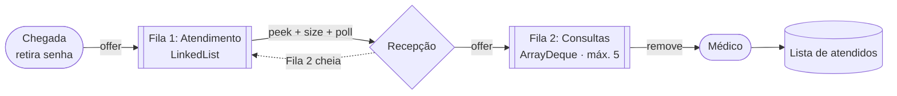

# 🏥 Sistema de Filas de Atendimento e Consultas


Trabalho prático de **Estruturas de Dados** (Ciência da Computação, 3º ano). Uma clínica é modelada com **duas filas FIFO**
usando a interface `java.util.Queue`. Também está feito o bônus de **atendimento prioritário** com `PriorityQueue`.

## 👥 Integrantes

- Lucas Steves
- Eduardo Souza
- Kaique Rebonato

## 🔄 Caminho do paciente



| Regra | Como foi feita |
|---|---|
| Retirar senha | O paciente entra no fim da Fila 1 (`offer`), com senha sequencial automática |
| Recepção | Sai da Fila 1 (`poll`) e entra na Fila 2 (`offer`) |
| Limite da Fila 2 | Conferido com `size()` **antes** do `poll()`: se estiver cheia, o paciente fica na Fila 1 e o sistema avisa |
| Consulta | Sai da Fila 2 com `remove()` e vai para uma `List<Paciente>` de atendidos |
| Filas vazias | `peek`/`poll` retornam `null`; o `remove()` lança `NoSuchElementException`, que é tratada no `Main` |
| ⭐ Bônus | Fila 2 como `PriorityQueue`: prioritários primeiro e, entre iguais, a menor senha |

## ▶️ Como executar

Requisito: **JDK 17 ou mais novo**.

```bash
# compilar
javac -encoding UTF-8 -d out src/*.java

# rodar o sistema
java -cp out Main

# rodar os testes
java -cp out TesteClinica
```

Ao iniciar, o sistema pergunta se o atendimento prioritário fica ativado:
- **n**: versão obrigatória, FIFO pura com `ArrayDeque`;
- **s**: bônus, com `PriorityQueue`.

```
===== CLÍNICA - FILAS =====
1 - Retirar senha
2 - Chamar próximo na recepção (Fila 1 -> Fila 2)
3 - Chamar próximo para consulta
4 - Listar fila de atendimento
5 - Listar fila de consultas
6 - Ver próximo de cada fila (peek)
7 - Relatório
0 - Sair
```

## 📁 Estrutura

```
src/
├── Paciente.java         # dados do paciente (senha automática, horários, prioridade)
├── ServicoClinica.java   # as duas filas e todas as regras de negócio
├── Main.java             # menu de console (Scanner), trata as exceções
└── TesteClinica.java     # 7 testes, sem biblioteca externa
Relatorio.pdf             # relatório: fluxograma, justificativas, métodos da Queue, Big-O, testes
```

## 🧠 Decisões principais

**Filas declaradas pela interface (polimorfismo)**

```java
Queue<Paciente> filaAtendimento = new LinkedList<>();
Queue<Paciente> filaConsultas   = new ArrayDeque<>();   // ou new PriorityQueue<>(ORDEM_PRIORIDADE)
```

O resto do código só usa métodos de `Queue`. Por isso, ligar o bônus muda **uma linha só**.

- **Fila 1 (`LinkedList`):** não tem limite e cresce e encolhe o tempo todo. Inserir no fim e remover do início é O(1), sem precisar redimensionar.
- **Fila 2 (`ArrayDeque`):** é pequena (no máximo 5) e por dentro é um array circular que nunca precisa crescer. Tudo é O(1), e como ela não aceita `null`, um `null` sempre significa "fila vazia".
- **Bônus (`PriorityQueue`):** por dentro é um heap. O iterador **não** segue a ordem de saída, então a listagem ordena uma cópia com o mesmo `Comparator`.

### Métodos da `Queue`

| Operação | Lança exceção | Retorna valor especial |
|---|---|---|
| Inserir | `add()` | `offer()` → `false` |
| Remover | `remove()` → `NoSuchElementException` | `poll()` → `null` |
| Consultar | `element()` → `NoSuchElementException` | `peek()` → `null` |

### Complexidade

| Operação | `LinkedList` | `ArrayDeque` | `PriorityQueue` |
|---|---|---|---|
| `offer` / `add` | O(1) | O(1) amortizado | O(log n) |
| `poll` / `remove()` | O(1) | O(1) | O(log n) |
| `peek` / `element` | O(1) | O(1) | O(1) |
| `size()` | O(1) | O(1) | O(1) |

## ✅ Testes

`java -cp out TesteClinica` executa:

1. Filas vazias não quebram o programa
2. Fila 2 cheia: o paciente fica na Fila 1
3. Fluxo completo de um paciente
4. `remove()` em fila vazia lança a exceção e ela é tratada
5. A ordem FIFO é preservada nas duas filas
6. Diferença entre `add`/`offer`, `remove`/`poll` e `element`/`peek`
7. Bônus: o prioritário passa na frente na Fila 2
